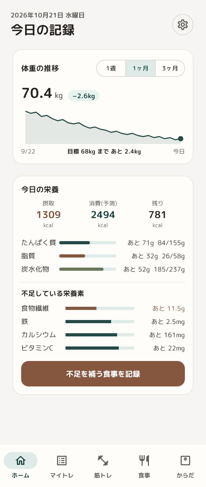
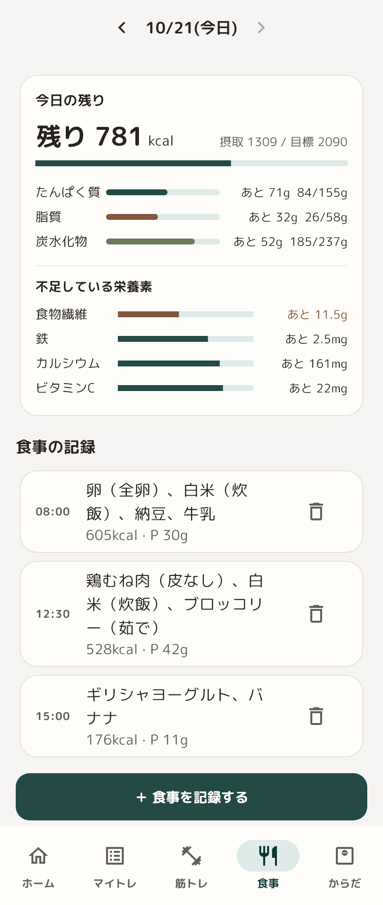
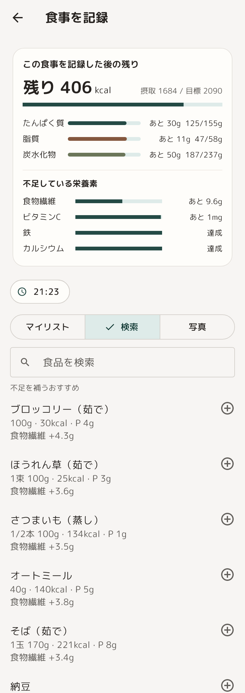
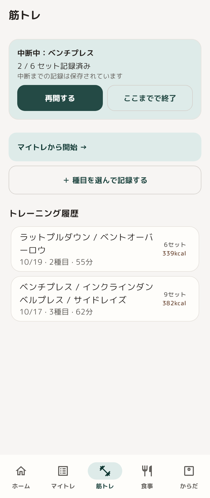
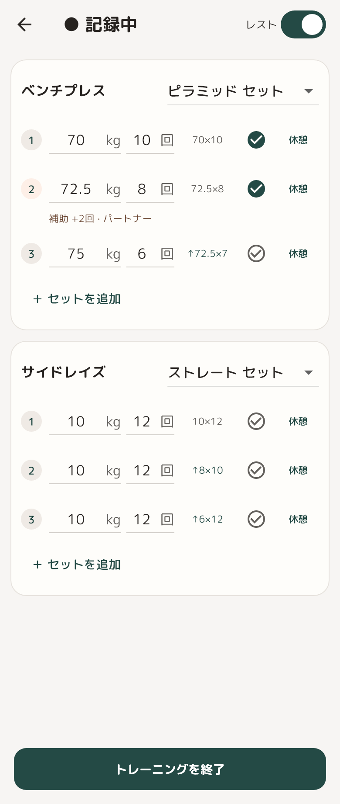
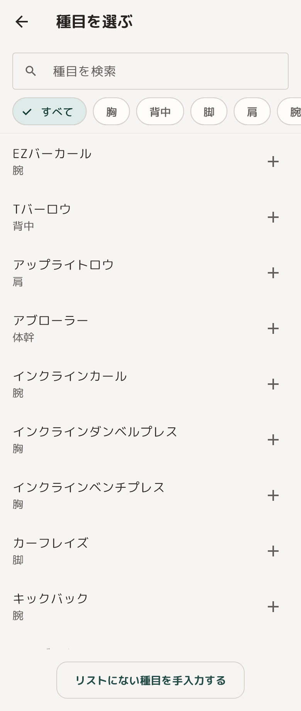
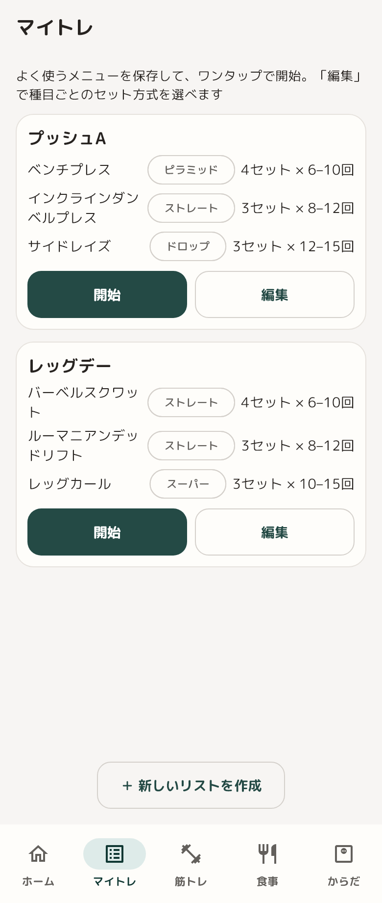
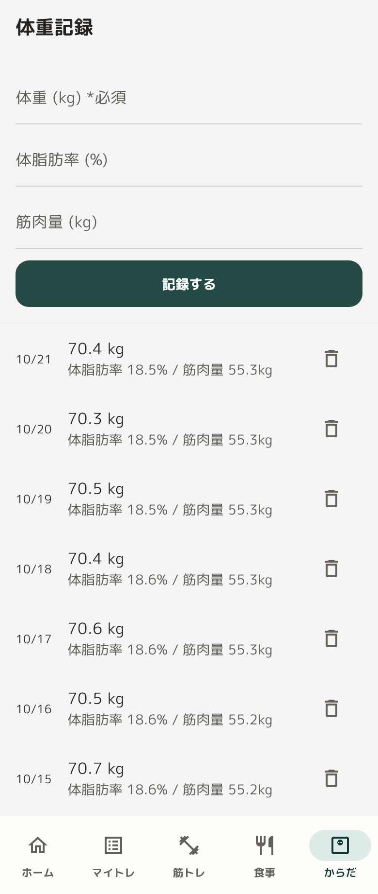
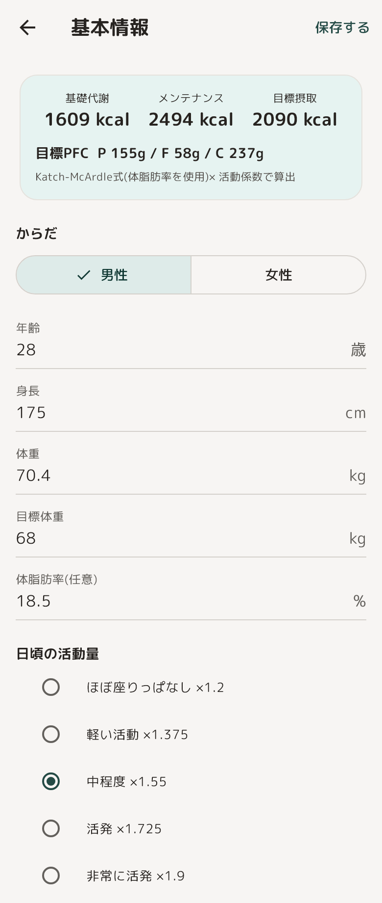
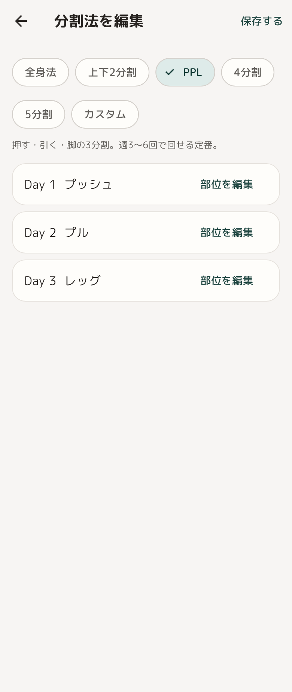

# フィットネス管理アプリ(個人開発)

筋トレの記録・食事管理・体重管理を1つにまとめた、スマートフォン向けアプリです。
「今日あと何を食べれば足りるか」「体重はどう推移しているか」を1画面で把握できることを目指しています。

- 開発状況: **開発中(ベータ版に向けて機能を順次実装)**
- 技術: Flutter / Dart、Drift(SQLite)、将来的にSupabase
- 設計・実装の意図は [コードの読み方ガイド](docs/code-guide.md) にまとめています

> このリポジトリは「完成品」ではなく、**要件定義 → 設計 → 実装 → テスト**を一通り自分で回しながら作っている過程そのものを見ていただくためのものです。
> 設計判断の理由や、割り切った点・未完成の点も隠さずドキュメントに書いています。

## 実装状況

| 機能 | 状態 | 概要 |
|------|------|------|
| ホーム | ✅ | 体重の推移グラフ(1週/1ヶ月/3ヶ月)、今日の摂取・消費・残りカロリー、PFC、不足している栄養素 |
| からだ(体重記録) | ✅ | 体重・体脂肪率・筋肉量の記録と一覧、削除 |
| 筋トレ記録 | ✅ | 種目選択(検索・部位フィルター・手入力)、セット記録(前回比較・レストタイマー・セット形式の切り替え・補助レップの記録)、中断/再開、履歴と消費kcal |
| マイトレ | ✅ | よく使う種目の組み合わせを保存し、ワンタップで開始 |
| 食事記録 | ✅ | 食品検索(不足を補うおすすめ順)、マイリスト、記録後の残りのプレビュー、時刻順のタイムライン |
| 基本情報 | ✅ | 身体情報・活動量・目的から基礎代謝/目標カロリー/目標PFCを自動計算、分割法の設定 |
| 進捗写真 | 未実装 | |
| ログイン / クラウド同期 | 未実装 | 現在は端末内のみ保存(オフライン前提) |
| AI機能 | 未実装 | 食事アドバイス・メニュー提案・写真からの食事認識(後フェーズでまとめて実装予定) |

## 画面イメージ

実装済みの画面です(サンプルデータを入れた状態)。

> これらは**実機・エミュレータのスクリーンショットではありません**。開発PCの都合でエミュレータが動かないため、アプリの画面部品(Flutterのウィジェット)をテスト環境でそのまま描画して書き出した画像です。配色・角丸は[デザイン見本](docs/design/)のトークンを適用済みで、フォントはアプリに同梱した丸ゴシック(M PLUS Rounded 1c)で描画しています。アイコン・ロゴはまだ適用していません。

<table>
  <tr>
    <td align="center" valign="top" width="20%"><br><sub><b>ホーム</b><br>体重の推移と今日の栄養</sub></td>
    <td align="center" valign="top" width="20%"><br><sub><b>食事</b><br>時刻順のタイムライン</sub></td>
    <td align="center" valign="top" width="20%"><br><sub><b>食事を記録</b><br>不足を補うおすすめ・残りのプレビュー</sub></td>
    <td align="center" valign="top" width="20%"><br><sub><b>筋トレ</b><br>中断中のトレーニングと履歴</sub></td>
    <td align="center" valign="top" width="20%"><br><sub><b>セット記録</b><br>前回比較・補助レップ・レスト</sub></td>
  </tr>
  <tr>
    <td align="center" valign="top"><br><sub><b>種目選択</b><br>検索・部位の絞り込み</sub></td>
    <td align="center" valign="top"><br><sub><b>マイトレ</b><br>よく使うメニューを保存</sub></td>
    <td align="center" valign="top"><br><sub><b>からだ</b><br>体重・体脂肪率・筋肉量</sub></td>
    <td align="center" valign="top"><br><sub><b>基本情報</b><br>基礎代謝・目標PFCを自動計算</sub></td>
    <td align="center" valign="top"><br><sub><b>分割法</b><br>プリセットと部位の編集</sub></td>
  </tr>
</table>

### 現時点の制約(正直に)

- **食品の栄養データは動作確認用の概算値**です。文部科学省「日本食品標準成分表」から正式に取り込んだものではありません(`app/lib/database/food_seed.dart`)。栄養素も現在は8種類(エネルギー・PFC・カルシウム・ビタミンC・鉄・食物繊維)のみです。
- 見た目は、[デザイン見本](docs/design/)の配色・角丸を適用済み(`app/lib/theme/app_theme.dart`)です。フォントは、デザイン見本の角ゴシックの代わりに、やわらかい印象の丸ゴシック(M PLUS Rounded 1c、SIL Open Font License)をアプリに同梱しています(約10MB)。アイコン・ロゴは未適用です。
- 開発PCの都合でエミュレータが動かず、**実機・エミュレータでの目視確認は未実施**です。現状は自動テスト(13件)と静的解析(`flutter analyze`)で品質を担保しています。上の画面イメージは、実機の画面ではなくテスト環境での描画です。
- 既知の課題と今後の改善点は [コードの読み方ガイド](docs/code-guide.md#6-割り切った点既知の課題) に書いています。

## 技術スタックと選定理由

| 層 | 技術 | 選んだ理由 |
|----|------|-----------|
| アプリ | Flutter (Dart) | 1つのコードでiOS/Androidに対応でき、実務でも広く使われているため |
| ローカルDB | Drift (SQLite) | オフライン対応が必須要件のため。型安全にSQLを扱える |
| クラウド(予定) | Supabase (PostgreSQL) | ローカルと同じ「SQL」で統一でき、認証・同期も任せられるため |

詳しくは [技術選定・開発方針](docs/tech-stack-and-conventions.md) を参照してください。

## ドキュメント

設計のドキュメントを先に書き、それに沿って実装する進め方をしています。

| ドキュメント | 内容 |
|--------------|------|
| [要件定義](docs/requirements-fitness-app.md) | 作るものと作らないもの、実装の優先度 |
| [技術選定・開発方針](docs/tech-stack-and-conventions.md) | 技術を選んだ理由、コーディング方針 |
| [DB設計](docs/db-schema-draft.md) | テーブル構造と、設計判断・方針変更の履歴 |
| [UI設計ブリーフ](docs/ui-design-brief.md) | UI設計ツールに渡した画面・UXの要件 |
| [UI設計(ハンドオフ)](docs/design/) | 動くプロトタイプと、画面ごとの仕様・配色・計算式 |
| [コードの読み方ガイド](docs/code-guide.md) | 全体構成、設計判断、データの流れ、既知の課題、ハマった点 |

## 開発の進め方

1. 要件定義 → 技術選定 → DB設計 → UI設計 の順にドキュメント化
2. 機能ごとに `feature/xxx` ブランチを切って実装し、Pull Requestで `main` に取り込む
3. 実装時は「なぜその書き方か」をコメントに残す
4. 画面・ロジックともにテストを書き、`flutter analyze` の警告をゼロに保つ

開発では、AIコーディングアシスタント(Claude Code)を使っています。要件・設計の判断は自分で行い、出てきたコードは意図を確認しながら取り込んでいます。コミットにはその旨のCo-Authored-Byを残しています。

## 動かし方

前提: Flutter SDK(3.x)がインストール済みであること。

```bash
cd app
flutter pub get
dart run build_runner build   # Driftのコード生成(データベース関連のコードを生成)
flutter run                   # 端末またはエミュレータで起動
```

```bash
cd app
flutter analyze   # 静的解析
flutter test      # テスト(13件)
```

> **注意(Windows)**: リポジトリを置くフォルダのパスに日本語などの非ASCII文字が含まれると、`build_runner` や `flutter analyze` がクラッシュすることがあります。英数字のみのパスに置いてください(詳細は [コードの読み方ガイド](docs/code-guide.md#7-開発中にハマったこと学び))。

## ロードマップ

1. 食品データを日本食品標準成分表から正式に取り込み、栄養素を拡充
2. アイコン・ロゴの作成と適用(配色・フォントは適用済み)
3. 進捗写真
4. 実機での動作確認と、実機のスクリーンショットへの差し替え
5. 大きい画面ファイルの分割、データ層の統一
6. ログイン・クラウド同期(Supabase)
7. AI機能(食事アドバイス・メニュー提案・写真認識)

## ディレクトリ構成

```
.
├── app/                 # Flutterアプリ本体
│   ├── lib/
│   │   ├── calc/        # 基礎代謝・目標PFCなどの計算ロジック
│   │   ├── data/        # データ層(食事の保存・集計、栄養目標)
│   │   ├── database/    # Driftのテーブル定義・初期データ
│   │   ├── screens/     # 画面
│   │   ├── theme/       # 配色・角丸・フォント
│   │   └── widgets/     # 共通部品
│   └── test/            # ユニットテスト・ウィジェットテスト
└── docs/                # 要件定義・設計・UI設計・コードガイド
```
