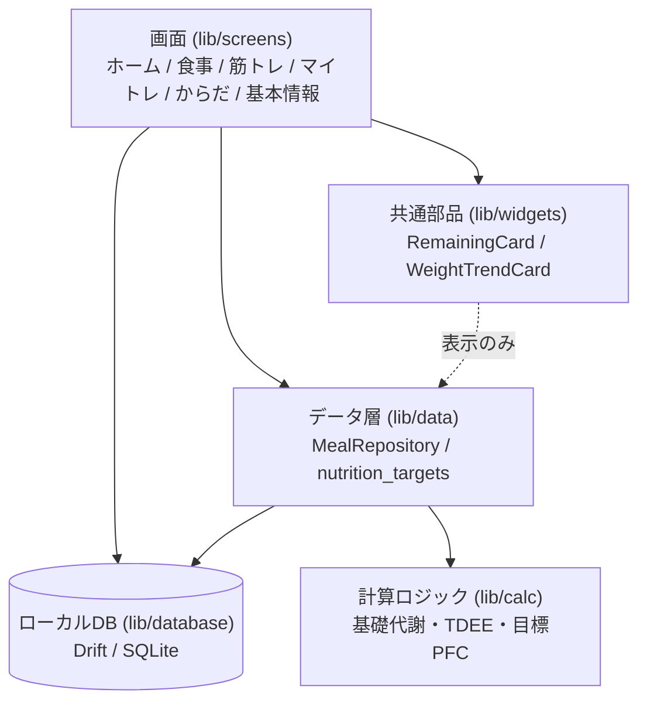
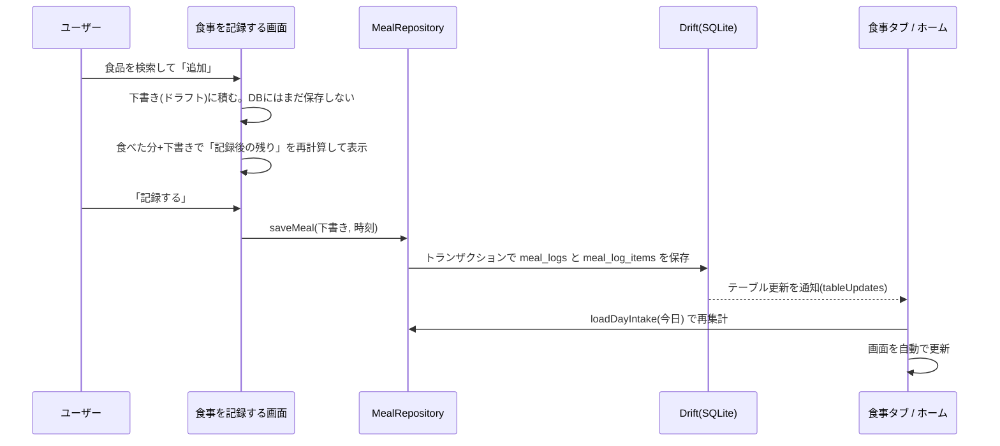

# コードの読み方ガイド

「動くコード」ではなく「なぜそう書いたかを説明できるコード」にすることを目標に、設計の意図・データの流れ・割り切った点・ハマった点を一箇所にまとめたドキュメントです。
(方針の背景は [技術選定・開発方針](tech-stack-and-conventions.md) の「コーディング方針」を参照)

- 対象: `app/` 配下のFlutterアプリ
- 更新: 2026年10月

## 1. 全体像

| フォルダ | 役割 | 主なファイル |
|----------|------|--------------|
| `lib/database` | テーブル定義・マイグレーション・初期データ | `app_database.dart`、`exercise_seed.dart`、`food_seed.dart` |
| `lib/data` | 画面から切り離したDB操作と集計 | `meal_repository.dart`、`nutrition_targets.dart` |
| `lib/calc` | UIに依存しない純粋な計算 | `nutrition_calc.dart` |
| `lib/screens` | 1画面1ファイルの画面 | `home_screen.dart` ほか |
| `lib/widgets` | 複数画面で使い回す部品 | `remaining_card.dart`、`weight_trend_card.dart` |
| `lib/theme` | 配色・角丸などの見た目(デザイン見本のトークン) | `app_theme.dart` |
| `test/` | ユニットテスト+ウィジェットテスト | 3ファイル・13テスト |

## 2. 設計判断とその理由

### ローカルファースト(Drift / SQLite)
要件で「オフラインでも使える」ことを必須にしたため、まず端末内のSQLiteに保存する構成にしました。クラウド同期(Supabase)は後から足す前提で、ローカル・クラウドとも同じテーブル構造にしてあります。
テーブルは [DB設計](db-schema-draft.md) に沿って定義しています。

### 栄養素を「列」ではなく「別テーブル」にした(正規化)
食品テーブルに「カロリー列・たんぱく質列・ビタミン列…」を並べると、栄養素を増やすたびにテーブル構造の変更が必要になります。
そこで `nutrients`(栄養素マスタ)と `food_nutrients`(食品×栄養素×量)に分け、**栄養素は行を足すだけで増やせる**形にしました。現在は8種類だけですが、構造は拡張を前提にしています。

### セットの形式を「グループ」で表す
通常セット・ドロップセット・スーパーセットなどを別々のテーブルにせず、`workout_set_groups.group_type` という1つの列で区別しています。
UI設計の途中で「スーパーセット」が追加されましたが、列の値を1つ増やすだけで対応できました。設計時の判断が活きた例です。

### 画面から切り離した層を作った(食事のみ)
食事は「100gあたりの量 × 食べたグラム数」の計算を複数画面(食事タブ・記録画面・ホーム)で使うため、DB操作と集計を `MealRepository` に集約しました。
計算が画面ごとに重複して食い違うのを防ぐ目的です。

### 計算ロジックを純粋関数にした
基礎代謝・目標カロリー・PFCの計算(`calcNutrition`)は、画面やDBに依存しない関数にしました。入力と出力だけで決まるため、手計算した期待値でのユニットテストが書けます。

### 見た目をテーマに集約した
配色・角丸は、[デザイン見本](design/)のトークンを `lib/theme/app_theme.dart` にまとめました。各画面は色を直接書かず、テーマの色(`Theme.of(context).colorScheme`)か、名前付きの定数(`AppColors`)を使います。後から配色を変えたい時に、1か所の修正で全画面に反映できるようにするためです。文字スタイルも標準のテキストテーマを元に作っているので、将来フォントを適用する時は、テキストテーマを差し替えるだけで済みます。

### 「1行だけのプロフィール」
認証機能がまだ無いため、基本情報(`profiles`)は常に1行だけを使い回し、無ければデフォルト値で作成します(`loadOrCreateProfile`)。認証導入時に、ユーザーIDを列に足す想定です。

## 3. データの流れ(例: 食事を記録する)

ポイントは2つです。

1. **下書きと保存を分けた**: 追加するたびに保存すると、キャンセルや量の修正のたびに削除処理が必要になります。「記録する」を押した時に1回だけ、トランザクションでまとめて保存します(途中で失敗して中身だけ欠ける、を防ぐ)。
2. **画面の更新はDBの変更通知に任せた**: 保存した側が「食事タブを更新して」と指示するのではなく、各画面が `tableUpdates` でテーブルの変化を監視して自分で再読み込みします。画面同士が互いを知らなくて済みます。

## 4. 計算式(`lib/calc/nutrition_calc.dart`)

| 項目 | 式 |
|------|-----|
| 基礎代謝(体脂肪率あり) | Katch-McArdle式: `370 + 21.6 × 除脂肪体重` |
| 基礎代謝(体脂肪率なし) | Mifflin-St Jeor式: `10×体重 + 6.25×身長 − 5×年齢 + (男+5 / 女−161)` |
| 消費カロリー(TDEE) | 基礎代謝 × 活動係数(1.2〜1.9)。実測値で上書きも可 |
| 目標摂取カロリー | TDEE + 目的の補正(減量−400 / 維持0 / 筋肥大+300 / 筋力+200)、10kcal単位に丸め |
| 目標PFC | P = 体重×2.0g(減量は2.2g)、F = 目標kcalの25%÷9、C = 残りを4で割る |

数値の検証は `test/nutrition_calc_test.dart` で、手計算した期待値と突き合わせています。

## 5. テストの方針

| 種類 | 対象 | ファイル |
|------|------|----------|
| ユニットテスト | 栄養計算、食事の保存・集計・削除、おすすめ順位付け | `nutrition_calc_test.dart`、`meal_repository_test.dart` |
| ウィジェットテスト | 体重記録、筋トレ記録、食事記録、基本情報の保存→再読み込み、ホーム表示 | `widget_test.dart` |

テストでは、ファイルを作らないインメモリDB(`AppDatabase.forTesting()`)を使うため、端末の実データに影響しません。

## 6. 割り切った点・既知の課題

正直に書いておきます。

- **画面が大きい**: `workout_logging_screen.dart` は約800行あります。セット行・補助レップのシートなどに分割するのが次のリファクタリング候補です。
- **データ層の統一が不十分**: 食事は `MealRepository` に集約しましたが、体重・筋トレは画面から直接DBを操作しています。同じ方針に揃える余地があります。
- **ジャイアント/スーパーセットは単一種目のみ**: DB構造は複数種目を1グループに入れられる設計ですが、画面側は1グループ=1種目です。
- **食品データは概算値**: 動作確認用の約35品目で、日本食品標準成分表からの正式取り込みは未実施です。
- **栄養素は8種類**: プロトタイプが扱っていた分だけです。残りのビタミン・ミネラルは行を足せば増やせます。
- **見た目は途中**: デザイン見本([docs/design](design/))の配色・角丸はテーマ(`app/lib/theme/app_theme.dart`)として適用済みです。フォント(IBM Plex Sans / Noto Sans JP)とアイコン・ロゴは未適用です。
- **全タブが同時に構築される**: 5つのタブを `IndexedStack` で保持しているため、起動時に全画面分の読み込みが走ります。タブ数が増えたら遅延構築への切り替えを検討します。
- **実機・エミュレータでの目視確認が未実施**: 開発PCの都合でエミュレータが動かず、現状は自動テストと静的解析(`flutter analyze`)で品質を担保しています。

## 7. 開発中にハマったこと(学び)

### Windowsで、パスに日本語を含むとFlutter/Dartのツールが落ちる
`dart compile`(`build_runner`が内部で使う)と `flutter analyze` が、パスに日本語(例: `活動\...`)があるとクラッシュしました。フォルダ名1つに日本語があるだけで再現します。
原因の切り分けとして、(1)最小のDartファイルでも再現するか、(2)日本語を含まないパスにコピーしたら直るか、を順に確認し、パスの文字コードが原因だと特定しました。リポジトリをASCIIのみのパスへ移して解決しています。

### 非同期のDB読み込みはテストで待ち方に工夫がいる
ウィジェットテストの `pumpAndSettle` は「アニメーションが終わるまで」しか待たないため、DBからの読み込みが終わる前に「落ち着いた」と判定されて失敗しました。目的の表示が出るまで少しずつ待つヘルパー(`pumpUntilFound`)を用意して解決しています。
また、`ListView` は画面外の要素を作らないので、縦長の画面サイズに設定して検証しました。

### Flutterのバージョンアップによる非推奨API
`RadioListTile` の `groupValue` / `onChanged` が非推奨になっていたため、新しい `RadioGroup` を使う書き方に直しました。解析ツールの警告をゼロに保つ運用にしています。

### 仕様(UI設計)に合わせて、先に決めたDB設計を変更した
当初は「体重は二重管理を避けるため `body_measurements` の最新値を使う」設計にしていましたが、UI設計プロトタイプの計算ロジックが体重・体脂肪率・年齢を基本情報の入力値として扱っていたため、`profiles` にも持たせる設計に改めました。変更の理由は [DB設計](db-schema-draft.md) に残してあります。

## 8. 次にやること

[README](../README.md) の「ロードマップ」を参照してください。
